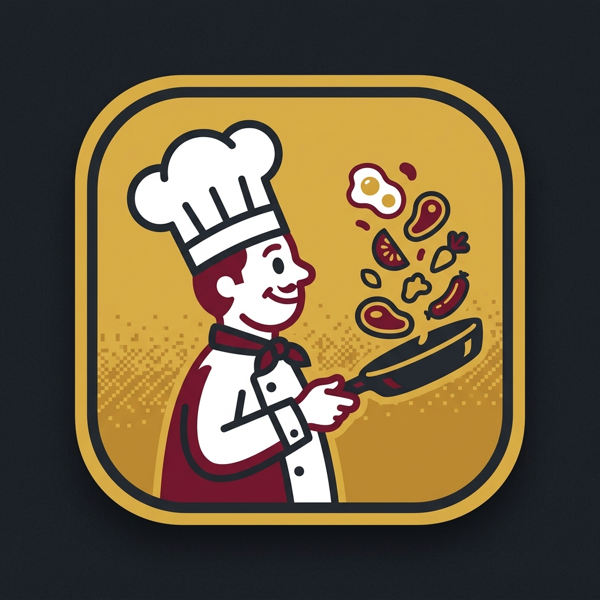

# 🍳 CHEF - (FP-24) Remake
(https://en.wikipedia.org/wiki/Game_%26_Watch)
[](https://react.dev/)
[](https://vitejs.dev/)
[](https://wails.io/)

> **Step into 1981.** A pixel-perfect, high-fidelity recreation of Nintendo's legendary **Game & Watch Wide Screen FP-24 "Chef"** arcade classic — engineered for modern web browsers and standalone Windows desktop.



---

## 🌟 Landing Page Copy & Overview

### 🏷️ Headline & Tagline
* **Headline:** Relive the Golden Age of Handheld Gaming.
* **Sub-headline:** The classic 1981 Nintendo Game & Watch "Chef" reborn with authentic LCD retro visuals, chiptune sound effects, and frantic pan-flipping arcade action.
* **Call to Action (CTA):** *Start Flipping* | *Download for Windows* | *Play in Browser*

---

## 📖 The Story & Gameplay

You are the master chef in a chaotic kitchen, frantically juggling breakfast ingredients in your frying pan! Sausages, fish, and eggs are flying through the air across four cooking lanes. Time your moves, catch the food before it hits the floor, and beware of kitchen mischief:

* **🍳 4-Lane Pan Flipping:** Slide smoothly between 4 cooking lanes to keep every ingredient airborne.
* **🐱 The Cat on the Shelf:** A mischievous cat lurks above, reaching out with its paw to catch food mid-flight, holding it hostage, and dropping it when you least expect it!
* **🐭 The Sneaky Mouse:** A nimble kitchen mouse occasionally drops in. Catch it for a whopping **+50 bonus** and watch it scare the cat away!
* **☕ Chef's Focus (Coffee):** Drink a cup of hot coffee to trigger **bullet-time slow motion**, giving you precious seconds to recover control during hectic multi-food drops.
* **🌟 Golden Ingredient (2X Multiplier):** Catch the rare golden breakfast to double all your points for 6 furious seconds!
* **❤️ 1-UP Milestone Clears:** Reach **200** and **500** points to clear all your accrued misses and get back into the action!

---

## 🕹️ Game Modes

| Mode | Description | Speed | Spawns | Cat Traps |
| :--- | :--- | :---: | :---: | :---: |
| **Easy Mode** | Relaxed pace with slower drops. Perfect for beginners and nostalgic casual play. | `0.7x` | Relaxed | Rare |
| **Game A (Normal)** | The authentic 1981 FP-24 experience. Standard progression and true-to-era speed. | `1.0x` | Dynamic | Moderate |
| **Game B (Hard)** | For arcade veterans. Fast drops, rapid spawns, and aggressive cat interference. | `1.4x` | Rapid | High |

---

## ⌨️ Controls

| Action | Keyboard | Touch / Mouse |
| :--- | :--- | :--- |
| **Move Left** | `←` Left Arrow or `A` | Click / Tap **LEFT** button |
| **Move Right** | `→` Right Arrow or `D` | Click / Tap **RIGHT** button |
| **Start / Restart** | `Space` or `Enter` | Click **START GAME** |
| **Mute / Unmute** | Audio icon in HUD | Click sound toggle button |

---

## 🎯 Key Features (For Marketing & Landing Page)

* **📺 Authentic Retro LCD Aesthetics:** Crisp LCD segments, vintage segmented scoring, and nostalgic handheld frame styling.
* **🎵 Classic Chiptune Audio:** Faithfully generated arcade beeps, boops, bonus jingles, and catch sounds with an instant mute toggle.
* **🏆 Persistent High Scores:** Independent high scores tracked for each game mode, saved directly in local storage.
* **⚡ Zero Input Lag:** Built on a 60 FPS `requestAnimationFrame` game loop with sub-millisecond input response.
* **💻 Portable Standalone Desktop App:** Packaged as a clean, single-file Windows executable (`ChefGame.exe`, under 19MB) with no installer, no console window, and fixed retro aspect ratio.
* **📱 Responsive & Cross-Platform:** Scales smoothly across desktop browsers, laptops, tablets, and phones.

---

## 🚀 How to Run & Build

### 1. Web Version (Development & Preview)
```bash
# Install dependencies
npm install

# Run Vite local dev server
npm run dev

# Build production web bundle into dist/
npm run build
```

### 2. Standalone Windows Desktop App
Build a standalone Windows executable (`desktop/ChefGame.exe`) using either command:

```powershell
# Using npm
npm run build:desktop

# Or using PowerShell directly
.\build_desktop.ps1
```

The resulting `desktop/ChefGame.exe`:
- Runs in native GUI mode without any console terminal.
- Has the custom Chef Game icon embedded.
- Fixed 900x700 window size to maintain the authentic retro handheld proportions.

---

